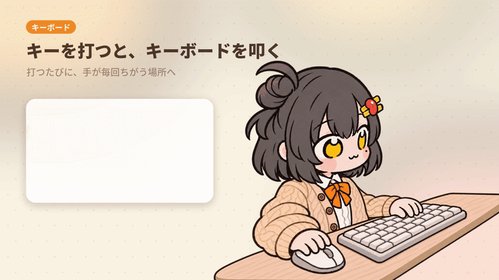
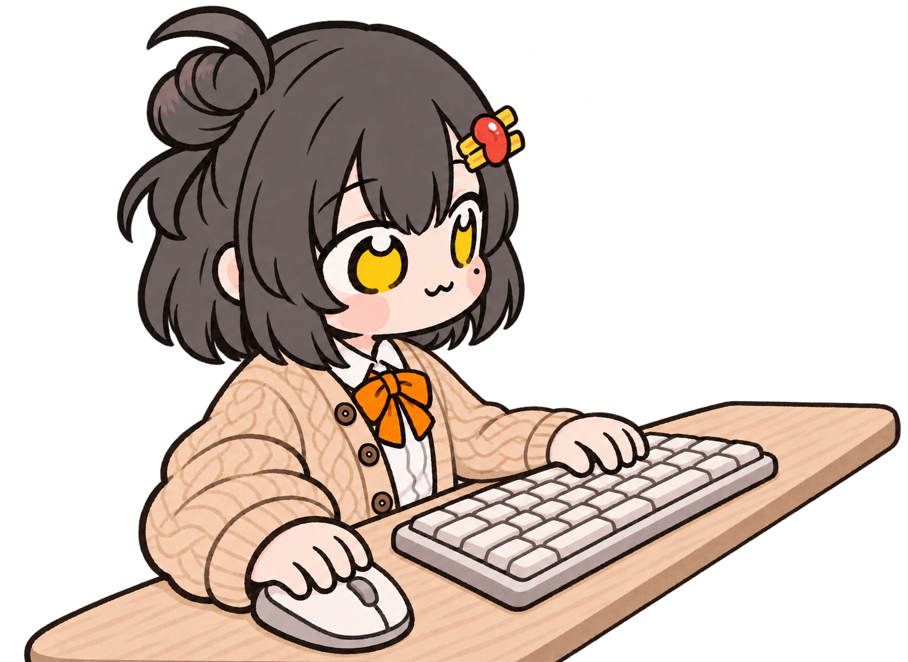
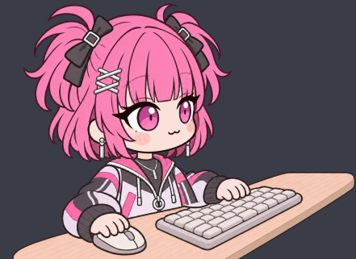
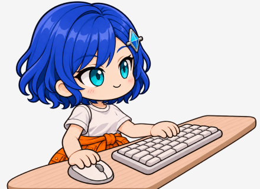

# Sumikko Mascot

<a href="README.md">日本語</a> | <strong>English</strong>

<strong>Give ChatGPT one picture of your character and one ready-made prompt, and get your own animated desktop mascot.</strong>

  
  
  
  
  

  

Sumikko Mascot is a little character that sits in a corner of your Windows desktop. It types on its keyboard when you type and moves its mouse when you move yours. No Live2D or PSD rig is involved: it runs on five transparent PNG images and drawing code. Inside the app it is called 隅っこキャラ (*Sumikko Kyara*, "the corner character").

The bundled Pink-chan and Koji-chan were each made from a single reference picture and the prompt in this repository. The AI did all of it: the key illustration, the layered parts, the measurements, adding them to the app and checking the motion.

> **About the language.** The app's menus are in Japanese. This guide and the [English usage guide](docs/en/usage.md) show each menu label together with its meaning, for example **キャラクター** (Character). You can talk to the AI in English when you make your own character.

## What you need

- **Windows** (tested on Windows 11 only; Windows 10 is expected to work but has not been tested; macOS and Linux are not supported)
- .NET Framework 4.x (included with Windows)

To make your own character you also need:

- **Codex in the ChatGPT desktop app**, or **Codex CLI**: an environment that can generate images and edit files and run commands in a folder. Check OpenAI's pages for which plans include it.
- Python 3 (the AI uses it for an image-checking tool; the app itself does not need it)

## Make your own mascot in 3 steps

1. **Download**
   Use **Code → Download ZIP** on this page and extract it, or `git clone` the repository.
2. **Give the AI your picture and the prompt**
   Open this folder in Codex (ChatGPT desktop app or Codex CLI). Attach a picture of the character you want, paste the text from the [character creation prompt](docs/en/character-creation-prompt.md) and send it. The only thing to change is the character name.
3. **Approve one picture**
   The AI shows you one key illustration of your character as a chibi sitting at a desk with a keyboard and a mouse, and asks whether it looks right. Reply OK if you like it. The AI then generates the parts, measures their positions, adds the character to the app and checks the motion on its own.

When it is done, start the app with `Start.cmd`, right-click the mascot and pick your character under **キャラクター** (Character). If the app was running while the character was made, quit it and start it again.

- The bundled characters were made with GPT-6 Astra (reasoning effort: medium).
- Every generation is different, so results vary. The AI can only check still frames, so judge the timing and feel of the motion by running it yourself.
- Only use a picture you are allowed to use. The bundled characters' pictures cannot be used as references (see [License](#license)).

To prepare the parts yourself, or to learn how characters are switched, see [Adding and switching characters](docs/en/characters.md).

## Try a bundled character first

Double-click `Start.cmd`. On the first run it builds the app with the C# compiler that comes with Windows, then starts it. Running the app needs no Python and no extra packages.

Right-click the mascot to switch characters and to change the size, the audio and the motion settings. **終了** (Quit) is in the same menu. See the [usage guide](docs/en/usage.md) for details.

## Trailer

A 57-second introduction (with sound; captions in Japanese).

https://github.com/user-attachments/assets/f4ac66c1-2760-4643-8265-25f2bc6cb0da

## What it does

- Its hand hits the keyboard when you press a key, and its other hand follows your mouse.
- It dozes off, waves hello, enjoys head pats and cheers when you finish typing.
- It lip-syncs to the volume of your microphone or of the sound your PC is playing.
- You can add as many characters as you like and switch between them from the menu.

## Bundled characters

| 妹尾トマリ Tomari (sample) | [Pink-chan](characters/pink-chan/README.md) | [Koji-chan](characters/koji-chan/README.md) |
| --- | --- | --- |
|  |  |  |
| `assets/` | `characters/pink-chan/` | `characters/koji-chan/` |

The folders of Pink-chan and Koji-chan also contain the prompts used to make them (`generation-prompts.json`) and a record of the fitting and checks (`README.md`, in Japanese).

All bundled characters are original characters by ろてじん (Rotejin). See [License](#license) for what you may do with them.

## Documentation

| Purpose | Read |
| --- | --- |
| Have the AI make a character from a reference picture | [Character creation prompt](docs/en/character-creation-prompt.md) |
| Menus, audio and motion settings | [Usage](docs/en/usage.md) |
| Add a character from your own parts, switch characters | [Adding and switching characters](docs/en/characters.md) |
| Reference sheets and prompts for generating parts | [Making the parts](assets/parts-reference/README.en.md) |
| Building, regression checks, source layout | [Development](docs/en/development.md) |
| Working rules for coding AIs | [AGENTS.md](AGENTS.md) (Japanese; AI tools read it as is) |
| Changes | [CHANGELOG.md](CHANGELOG.md) |
| Contributing | [CONTRIBUTING.md](.github/CONTRIBUTING.md) |

## Troubleshooting

### Windows shows a warning when I start it from the ZIP

Files downloaded from the internet can trigger warnings such as "Windows protected your PC". Before extracting, right-click the ZIP → **Properties** → check **Unblock** at the bottom → **OK**, then extract it. The warning will not appear.

### The mascot does not appear

- If its face icon is in the notification area (the right end of the taskbar; it may be inside the **^**), the app is already running (it never starts twice). Right-click the icon → **表示** (Display) → **画面内に戻す** (Bring back on screen) to move it to the lower right of the screen with the pointer. If you hid it, choose **表示する** (Show).
- If there is no icon, open `Start.cmd` again and look for an error in the black window. When the build fails, that window stays open.

### The build fails

- The app is built with the .NET Framework 4 C# compiler that comes with Windows (`C:\Windows\Microsoft.NET\Framework64\v4.0.30319\csc.exe`). If that file is missing, install .NET Framework 4.8 from Microsoft.
- If that does not help, [open a bug report](https://github.com/rotejin/sumikko-mascot/issues/new/choose) with the messages from the black window.

### My new character is not in the menu

- Check that `characters/<folder name>/` contains the required PNG files and `character.txt` ([Adding and switching characters](docs/en/characters.md)).
- If you made it while the app was running, quit the app and start it again.

### The mouth does not move

Audio is always off when the app starts. Right-click the mascot → **音声** (Audio) to choose a source. If it reacts too little, raise the sensitivity in **音声 → オーディオデバイス設定…** (Audio → Audio device settings…). See [Lip sync](docs/en/usage.md#lip-sync-audio).

## Updating

**With git**: right-click the mascot → **終了** (Quit) → `git pull` → open `Start.cmd`. When the source has changed, `Start.cmd` rebuilds the app automatically. Your settings in `bin\` are kept.

**With a ZIP**: extract the new ZIP to a new folder and copy these from the old folder to the same places:

- `bin\settings.txt` and `bin\tuning*.txt` (position, size, audio, motion settings)
- the folders of characters you made (`characters\<folder name>`)

## Uninstalling

Quit the app (right-click → **終了**) and delete the folder. Settings are stored only in `bin\` inside the folder. Nothing is written to the registry or to Windows startup.

## Questions and bug reports

Open an [issue](https://github.com/rotejin/sumikko-mascot/issues/new/choose) and pick a template. [SUPPORT.md](.github/SUPPORT.md) lists what to include. Do not post vulnerabilities in public issues; follow [SECURITY.md](.github/SECURITY.md). Questions in English are welcome.

## Privacy

Your input is used only to animate the mascot. Typed text and audio are never recorded; only the volume of the audio is used. The app makes no network connections. Settings such as position, size and audio device are saved in the local `bin/` folder.

## About the name

*Sumikko* (すみっこ) means "the little corner" in Japanese: a companion that sits in a corner of your screen. The project is not affiliated with San-X's "Sumikko Gurashi", and it is not an official OpenAI tool.

## License

The source code, scripts and documents are under the [MIT License](LICENSE).

**The character images are not MIT-licensed.** The bundled characters (Tomari, Pink-chan and Koji-chan) are original characters by ろてじん (Rotejin) and may be used only as described in the [asset license (ASSETS.md)](ASSETS.md):

- **Pink-chan and Koji-chan**: you may use them as the mascot on your own PC and show them in non-commercial posts, streams and videos.
- **Tomari**: for trying the app, and for non-commercial social media posts about that trial only. She may not appear in streams or other videos.
- None of them may be used as your own character, extracted for other uses, or used commercially.

Characters you make from your own pictures are yours (follow the rights of your source picture and the terms of the image generator you used).
