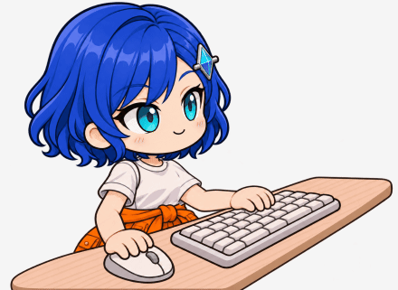
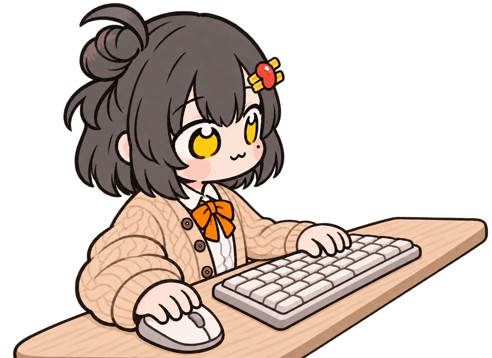
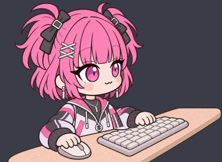
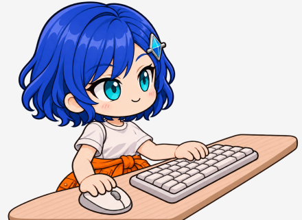

# Sumikko Mascot（隅っこキャラ）

**ChatGPT に「作りたいキャラクターの画像 1 枚」と「用意されたプロンプト 1 つ」を渡すだけで、自分だけのデスクトップマスコットが作れます。**

Windows のデスクトップの隅っこで、あなたのキー入力やマウス操作に合わせてキーボードを叩いたり、マウスを動かしたりするキャラクターです。Live2D や PSD は使わず、透過 PNG と描画コードだけで動きます。アプリの中では「隅っこキャラ」という名前で表示されます。

同梱の「ピンクちゃん」と「工事ちゃん」は、どちらも参考画像 1 枚とこのリポジトリの依頼文から作ったキャラクターです。完成図、パーツ画像の生成、位置合わせ、組み込み、動作検査まで AI が行っています。

> English summary is [at the bottom](#english).

## 必要なもの

- **Windows**（動作確認は Windows 11 のみです。Windows 10 でも動く見込みですが、確認していません。macOS・Linux では動きません）
- .NET Framework 4.x（Windows に標準で入っています）

自分のキャラクターを作る場合は、さらに次のものが必要です。

- **ChatGPT デスクトップアプリの Codex** または **Codex CLI**（画像生成と、フォルダ内のファイル編集・コマンド実行ができる環境）。利用できるプランは OpenAI の案内を確認してください
- Python 3（AI が画像の照合ツールで使います。アプリの実行には不要です）

## 3 ステップで自分のマスコットを作る

1. **ダウンロードする**
   このページの **Code → Download ZIP** で取得して展開するか、`git clone` します。
2. **AI に画像とプロンプトを渡す**
   ChatGPT デスクトップアプリの Codex（または Codex CLI）で、このフォルダを開きます。作りたいキャラクターの画像を添付し、[キャラクター制作の依頼文](docs/character-creation-prompt.md) の文章を貼り付けて送ります。書き換えるのは【キャラクター名】だけです。
3. **完成図を 1 回だけ確認する**
   AI が「机でキーボードとマウスを操作するちびキャラ」の完成図を 1 枚見せて、確認を求めます。よければ OK と返事をします。あとは、パーツ画像の生成、位置合わせ、アプリへの組み込み、動作検査まで AI が進めます。

できあがったら `Start.cmd` で起動し、キャラを右クリック → **キャラクター** から選びます。アプリの起動中に作った場合は、一度終了してから起動し直してください。

- 制作の確認には、GPT-6 Astra（推論 medium）を使いました。
- 生成結果は毎回異なるため、仕上がりには差が出ます。AI が確認できるのは静止したコマだけなので、動きのテンポや印象は実際に動かして確かめてください。
- 渡す画像は、自分が使ってよい画像にしてください。

自分で画像を用意して組み立てる方法や、キャラクターの切り替えについては [キャラクターの追加と切り替え](docs/characters.md) を見てください。

## まず同梱のキャラで動かしてみる

`Start.cmd` をダブルクリックします。初回は Windows 標準のコンパイラでビルドしてから起動します。アプリの実行に Python や外部パッケージは要りません。

キャラを右クリックすると、キャラクターの切り替え、表示サイズ、音声、動きの設定を変えられます。終了もこのメニューから行います。詳しくは [使い方](docs/usage.md) を見てください。

## できること

- キーを打つと手がキーボードを叩き、マウス操作に手元が連動します。
- 居眠り、あいさつ、なでなで、打ち終えたときに喜ぶしぐさがあります。
- マイクや PC の再生音の音量に合わせて口パクします。
- キャラクターを何人でも追加して、メニューから切り替えられます。

## 同梱のキャラクター

| 妹尾トマリ（見本） | [ピンクちゃん](characters/pink-chan/README.md) | [工事ちゃん](characters/koji-chan/README.md) |
| --- | --- | --- |
|  |  |  |
| `assets/` | `characters/pink-chan/` | `characters/koji-chan/` |

ピンクちゃんと工事ちゃんのフォルダには、制作に使った指示文（`generation-prompts.json`）と、調整・検証の記録（`README.md`）も入っています。

## ドキュメント

| 目的 | 読むもの |
| --- | --- |
| 参考画像から AI にキャラを作ってもらう | [キャラクター制作の依頼文](docs/character-creation-prompt.md) |
| 操作・音声・動きの調整 | [使い方](docs/usage.md) |
| 自分で用意した画像でキャラを追加する、切り替える | [キャラクターの追加と切り替え](docs/characters.md) |
| 画像生成用の参考シート・パーツの仕様 | [パーツ制作ガイド](assets/parts-reference/README.md) |
| ビルド・回帰検査・ソースの構成 | [開発と検証](docs/development.md) |
| コーディング AI 向けの作業の決まり | [AGENTS.md](AGENTS.md) |

## プライバシー

入力はキャラの反応のためだけに使い、入力した文字や音声は記録しません。音声は音量だけを取得します。ネットワーク通信は行いません。位置・表示・音声デバイスなどの設定は、手元の `bin/` フォルダに保存します。

## 名前について

Sumikko（すみっこ）は日本語で「隅っこ」という意味です。画面の隅っこにいる相棒、という意味で名付けました。サンエックスの「すみっコぐらし」とは関係ありません。また、OpenAI の公式ツールではありません。

## ライセンス

ソースコード・スクリプト・文書は [MIT License](LICENSE) です。**キャラクター画像は MIT の対象外**で、再利用には別途許可が必要です。詳しくは [ASSETS.md](ASSETS.md) を見てください。

## English

**Sumikko Mascot** turns one character picture and one prompt into an animated desktop mascot for Windows. *Sumikko* means "the little corner" in Japanese: the mascot sits in a corner of your screen, typing on its keyboard and moving its mouse along with you.

- **Try it**: double-click `Start.cmd`. Windows only (tested on Windows 11). It builds with the .NET Framework compiler that ships with Windows; no extra packages are needed to run it.
- **Make your own**: open this folder in Codex (ChatGPT desktop app or Codex CLI), attach a picture of your character, and send the prompt in [docs/character-creation-prompt.md](docs/character-creation-prompt.md) with the character name filled in. After you approve a single key illustration, the AI generates the layered parts, measures their positions, adds the character to the app and runs the checks. The bundled Pink-chan and Koji-chan were made this way.
- The documentation and the prompt are written in Japanese.
- Code, scripts and documents are under the MIT License. **The character images are not MIT-licensed**; see [ASSETS.md](ASSETS.md).
- Not affiliated with OpenAI, or with San-X's "Sumikko Gurashi".
