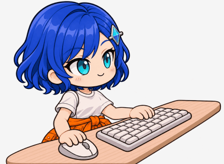

# 工事ちゃん

青いボブ、水色の瞳、ひし形の髪飾り、白い半袖と腰に結んだオレンジの作業着を引き継いだデスクトップキャラです。2026-11-17、利用者が承認した `key.png` を基準に制作しました。

## 使い方

リポジトリ直下の `Start.cmd` で起動し、キャラを右クリック → **キャラクター → 工事ちゃん** を選びます。既存キャラとPCの設定ファイルは変更していません。



## 素材と調整

`base.png`（体・首・机・キーボード）、`keyboard-arm.png`、`mouse-arm.png`、`head.png`、`eyes-closed.png`、`mouth-open.png` の6枚を使用します。内蔵画像生成ツールで制作し、透過を保持しています。生成指示と頭の作り直し理由は `generation-prompts.json` にあります。頭の初回出力は縦横比が違ったため不採用とし、1469×1071で再生成しました。他の素材は1470×1070程度で、既存の読み込み処理が1469×1071へ揃えます。

位置は正規化後の画素・輪郭から測定し、`character.txt` に設定しました。本体の描画コードは変更していません。

| 調整箇所 | 採用値と理由 |
| --- | --- |
| 首・頭 | 首は体側、回転中心558,586、上昇量5。あごの裏まで首を延ばし、居眠り時の接続も確認 |
| 目 | 開眼と閉眼の両方を囲む多角形と曲線方式。まばたき0〜1を0.1刻みで書き出し |
| 口 | 開いた口の暗い画素の範囲638〜683,476〜516。切り出し中心661,496・半径31,29。周囲の肌色253,220,198 |
| 奥腕 | 手首円弧の中心890,735、半径約36。付け根650,705、軸-0.10,0.995、変形部分の長さ194。腕全体から手首を分割 |
| 手前腕 | 肩の固定線635、手首853。移動範囲は左右±65、上下-32〜0。マウスが下端から出ないよう下方向を制限 |
| 動き | 素肌の手首の継ぎ目を守るため、手の拡大・しなり・振り上げを控えめに設定。あいさつ75、喜ぶしぐさ72 |
| 髪・記号 | ボブは頭と一緒に動かし、独立したアホ毛は無効。記号の基準位置960,240 |

## 検証記録

- `check_layers.py`：必須素材・透過の検査に合格。完成図との明確な差4.50%。重ね合わせを目視し、大きな位置ずれがないことを確認。描き足した肩・首・隠れていた机や、生成による輪郭の微差を含みます。
- `verify.ps1`：299項目すべてPASS。本体コンパイル・工事ちゃんの設定読み込みと描画・見本の静止画出力も成功。
- `build.ps1`：成功。検証専用フォルダに工事ちゃんを選ぶ設定を作り、同じ本体を `--smoke-test --demo` で起動。3.99秒で正常終了、終了コード0。利用者の `bin/settings.txt` や調整ファイルは検証に使用していません。
- 実際の描画コードで、通常、まばたき全11段階、口パク7段階、単発打鍵、連打、Enter、長押し、マウス四隅とクリック、あいさつ、なでなで、喜ぶしぐさ、あくび、居眠り、起床を出力。
- 明暗の背景それぞれ262枚、計524枚を出力。代表コマを通常表示幅440px相当と原寸で確認し、首まわりは2倍でも確認しました。すべてのコマを個別目視したわけではありません。
- 別担当による独立レビューを実施。確認した代表コマでは肩・首・手首の大きな穴や分離はありません。

検証画像・ログは `preview/koji-chan/` に書き出しました。`preview/` は Git で管理していないため、このリポジトリには含まれていません。下の「再出力」の手順で作り直せます。

再出力：

```powershell
powershell -NoProfile -ExecutionPolicy Bypass -File characters/koji-chan/verify-visuals.ps1
.venv/Scripts/python.exe tools/parts-sheet/check_layers.py characters/koji-chan/key.png characters/koji-chan preview/koji-chan/layer-check.png
powershell -NoProfile -ExecutionPolicy Bypass -File verify.ps1
```

## 残る制約

まばたき途中では、原寸で目の下辺が直線的に見え、閉じる直前に細く瞳が残ります。既存の描画方式の制約で、半目を長く保持する用途には向きません。通常のまばたきは短時間で通過します。暗い背景では黒いzzzなどが読みにくいことがあります。

プレビューはアプリと同じ描画コードの静止コマから作った10fpsのGIFです。実機の滑らかさ、入力への体感的な追従、マイクやPC音声を使った口パクは未確認です。実機で動きの印象を確認してください。
